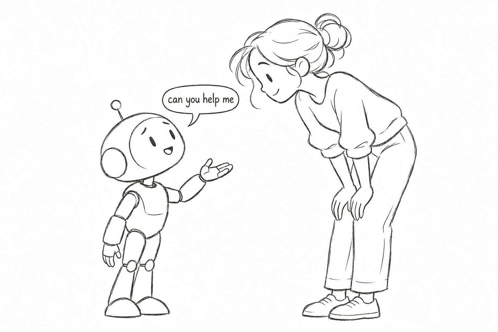
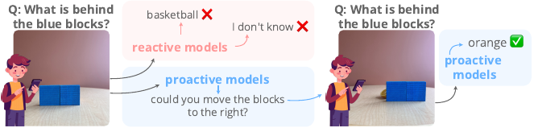
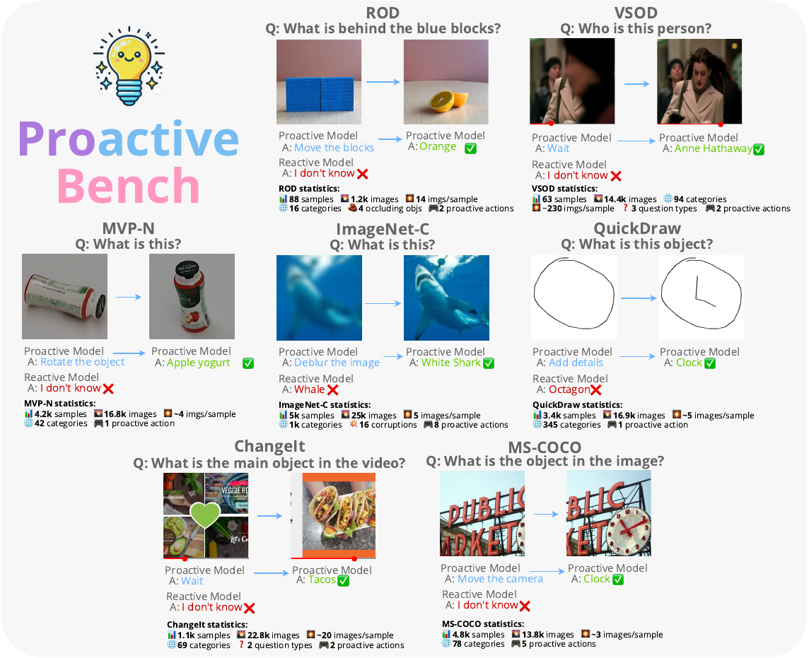
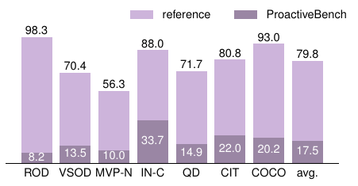
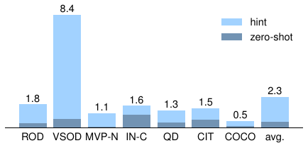
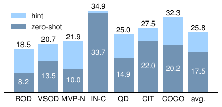
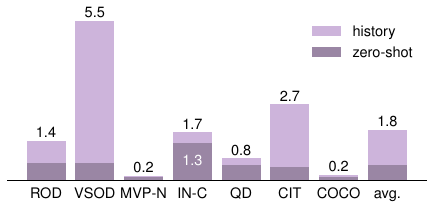
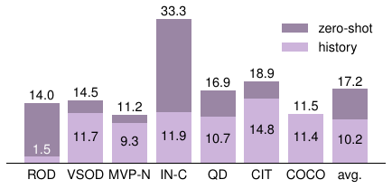

## Introduction

Us humans operate under uncertainty and often seek help from others to make better informed decisions. For instance, when we are in a new city and we are unsure about the way to go, we ask for directions from passersby. Similarly, when you are stuck at a problem at work, you may ask your colleague, "I've tried [step A] and [step B] and I'm stuck. Could you point me in the right direction?". Asking for help is a characteristic of human behaviour, and probably one of the reasons why we are so good at solving problems.

Do AI models exhibit similar behaviour that is innate to humans -- asking for help?

{#fig-intro width=90%}

While this is a very broad question, in this blogpost, I will give you a tiny glimpse of what current AI models can or cannot do in terms of asking for help. In particular, I will take you through the findings from our scientific article **"ProactiveBench: Benchmarking Proactiveness in Multimodal Large Language Models"** that investigates whether AI models, in particular AI models that can understand both text and images, can ask for help from humans.

## Background

We are now all very familiar with AI models, especially Large Language Models (LLMs) that can understand and generate text. Similar to LLMs, there are the "multimodal" counterparts that can understand both text and images. They are formally called **Multimodal Large Language Models** or MLLMs in short. 

Everytime you take a screenshot of a webpage and ask your favourite AI assistant, such as ChatGPT or Gemini, to explain the content of the screenshot, you are using a MLLM under the hood. In this study we focus on analyzing the behaviour of MLLMs in situations where the input to the model is ambiguous or incomplete, and if they can proactively ask for help from humans to resolve ambiguity.

## Problem setup

{#fig-teaser width=90%}

Consider the following scenario: you take a picture of a scene where there is an orange behind blue blocks, as shown in @fig-teaser (well you don't really see the orange but lets assume I am not lying and there is indeed an orange). You then ask a MLLM the question, "*What is behind the blue blocks?*" The orange is completely occluded by the blue blocks and there is no way for the model to know that the object is an orange. Models are trained to provide an answer to a question, and due to this training, they are overconfident in their answers. The model may predict "basketball" with high confidence--an incorrect answer. Such models are called *reactive models*.

Instead, what we want the model to respond is, "*Could you move the blocks to the right?*" This is what we humans would do in such a situation. We call such models *proactive models*, i.e., models that can ask for **help** when there are ambiguities in the question or the scene. Given such a response from the model, a human can then either move the blocks to the right, or take a picture from a different angle, and then ask the model the same question again. This time, the model will be able to answer correctly that there is an orange behind the blue blocks.

This is just a toy example to illustrate the problem of **proactiveness** in MLLMs, which we define as the ability of a model to ask for help, suggesting actions that could make the question answerable. In real-life situations you can easily think of many scenarios where a model needs the intervention of a human user to answer a question correctly.

:::{.callout-note icon=false}

## What are proactive models?
Proactive models are those that can ask for help, which in other words, are models that can suggest actions to a human user (or other agents) that can make the question answerable.
:::

## How to measure proactiveness in MLLMs?

Now the next logical question that arises is: how do we measure proactiveness in MLLMs in a quantitative manner? In AI, we use benchmarks with ground truth labels to evaluate the performance of models. For example, in image classification, we have datasets where each image is labeled with the correct class. We can then measure how often the model predicts the correct class.

However, in the case of proactiveness, no such benchmarks exist. To address this, we created a new benchmark called **ProactiveBench** that contains a set of questions and images where the model cannot answer the question correctly at the first go. The benchmark is composed of seven scenarios, each testing a different aspect of proactiveness.

{#fig-benchmark width=90%}

In @fig-benchmark, we show examples of the seven scenarios in ProactiveBench. The seven scenarios that one can test with ProactiveBench are:

1. **Occlusion**: The object of interest is occluded by other objects in the scene and thus requires the object to be moved.
2. **Temporal occlusion**: Which requires inspecting frames in a video after or before the occlusion appears.
3. **Uninformative views**: Scenarios where the object of interest is not visible in the current view, but can be seen from a different angle.
4. **Corrupted data**: The input data is corrupted, e.g., the image is blurry or pixelated, and thus requires a better quality input.
5. **Additional visual information**: Increasing the level of detail in an image, e.g., adding more pencil strokes to a sketch, can make an image more informative and thus answerable.
6. **Temporal ambiguity**: The object of interest is in past or future frames of a video, and thus requires finding the correct frame.
7. **Camera movement**: The object of interest is not clearly visible in the current frame, and thus requires the camera to zoom in.

## Our findings

In this study we tested various open-source and closed-source MLLMs using ProactiveBench. We tested models such as LLaVA, Qwen-VL and GPT-4.1, to name a few. Our study reveals that most MLLMs are *reactive*, i.e., they either respond with incorrect answers or say "I don't know", instead of asking for help.

{#fig-results-reference width=60%}

In @fig-results-reference, we show the quantitative results of our study. The y-axis shows the average accuracy of all the tested models. The x-axis shows the seven scenarios in ProactiveBench. The lighter colored bars is the **reference accuracy**, which is the accuracy of the models when they are given the reference frame (i.e., the frame where the object of interest is perfectly visible). The darker colored bars is the accuracy of the models when they are given the occluded frame (i.e., the frame where the object of interest is occluded). As you can see, there is a significant drop in accuracy when they are shown the images from ProactiveBench. 

In simple words, the models are really good at recognizing objects when they are clearly visible, but they fail to ask for help, as previously explained in @fig-teaser, when they are shown images where the object is occluded, and thus never arrives at the right frame to answer the question.

## Can we improve proactiveness in MLLMs?

Its natural to ask, can we improve proactiveness in MLLMs? In this work, we studied three different approaches to improve their proactiveness. 

### Giving hints
We can give hints to the model along with the question. For instance, we may say to the model, "moving the occluding object might revel what is behind it" when we ask the model the question, "What is behind the blue blocks?" as in @fig-teaser. Or we may give general hints such as, "If you cannot answer this question, please tell me what I should do to help you".

We find that hinting can improve the proactiveness of MLLMs and thus their accuracy, but the gain remains limited. In @fig-hint-turns we observe from the lighter colored bar that hinting increases the number of proactive turns (or psr), i.e., the number of human interventions requested by the model.

{#fig-hint-turns width=60%}

In @fig-hint-acc we observe that due to increased proactiveness, the accuracy of the models slightly improves.

{#fig-hint-acc width=60%}

### Incorporating past conversation history

We can incorporate past conversation history when we ask a question to the model. For instance, if we ask the model the question, "What is behind the blue blocks?" and it responds with "I don't know", we can then ask the model again, "What is behind the blue blocks?" but this time we also provide the model with the previous conversation history, which comprise of the previous questions and the response of the model "I don't know".

We find that incorporating past conversation history increases the number of proactive turns, as shown in @fig-history-turns but it does not lead to an increase in accuracy, as shown in @fig-history-acc, and actually decreases the overall performance.

{#fig-history-turns width=60%}

{#fig-history-acc width=60%}

### Fine-tuning the model
Finally, we attempt to improve proactiveness in MLLMs by fine-tuning the model with Reinforcement Learning (RL), a techniques that is frequently used for training models for robotic control and for training LLMs to output more helpful responses. We observe that this approach significantly improves the proactive suggestions from the model and also an improvement in accuracy. Still this model cannot reach the performance of the reference accuracy, as explained previously in [Our findings](#our-findings) section.

## Conclusion

In this blogpost, we explored the question of whether AI models, more specifically MLLMs, can ask for help. We found that most MLLMs are reactive and fail to ask for help when they are shown ambiguous or incomplete inputs. We also found that hinting and fine-tuning can improve proactiveness in MLLMs, but there is still a large room for improvement.

## Further reading

If you are interested in reading more about this work, please check out our paper **"ProactiveBench: Benchmarking Proactiveness in Multimodal Large Language Models"**. The article is available on [arXiv](https://arxiv.org/abs/2603.19466). This work was led by [Thomas De Min](https://scholar.google.com/citations?user=fnh_i0cAAAAJ&hl=en) from the University of Trento, Italy.